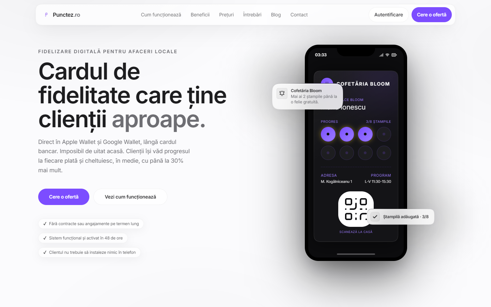
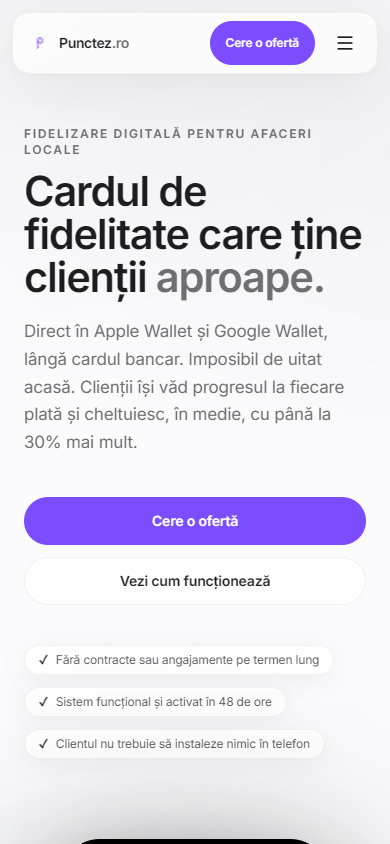
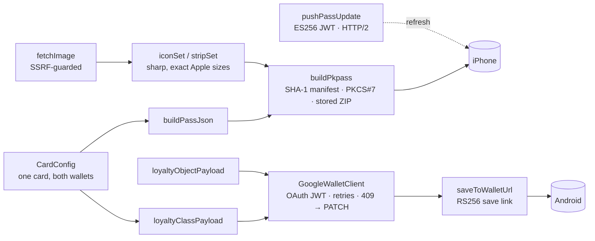

# punctez-wallet-kit

**Issue loyalty cards to Apple Wallet and Google Wallet from one config. PassKit signing, live updates over APNs, Google Wallet REST and save links, in about 800 lines of TypeScript with two dependencies.**

This is the open core of **[Punctez.ro](https://punctez.ro)**, a digital loyalty-card SaaS for local businesses in Romania: customers scan a QR at the counter, get a real Wallet pass, and see their stamps update on the lock screen. The product itself (dashboard, onboarding, scanner, billing, anti-fraud, analytics) stays closed. This kit is the wallet layer underneath it, cleaned up and decoupled from the database.

<p align="center">
  
  
</p>

## What's inside



| module | does |
|---|---|
| `apple/pass-json.ts` | `pass.json` for a `storeCard`: live stamp counter, `{stamps}` sentinel, badge mode, back fields, up to 10 lock-screen locations, localisable labels |
| `apple/pkpass.ts` | SHA-1 manifest, **detached PKCS#7 signature** with the Pass Type ID cert + WWDR chain (node-forge), assembled `.pkpass` |
| `apple/zip.ts` | a hand-written stored-ZIP writer/reader with CRC-32, so no zip dependency |
| `apple/images.ts` | SSRF-safe image fetch (private ranges, cloud metadata, redirects refused, 8 MB and 16 MP decode caps), icons/logos/strips resized to Apple's exact pixel sizes, a neutral default icon rendered from SVG |
| `apple/auth-token.ts` | per-pass web-service token derived with an HMAC (nothing stored), constant-time verification |
| `apple/apns.ts` | ES256 provider token in JOSE form, background pushes to every registered device over one HTTP/2 session |
| `google/jwt.ts` | RS256 signing with `node:crypto` (no `googleapis` SDK), cached OAuth tokens, "Add to Google Wallet" links |
| `google/payloads.ts` | LoyaltyClass per business, LoyaltyObject per customer, short codes under the QR, per-customer `{name}` rewards, notification patches |
| `google/client.ts` | REST client: exponential backoff with jitter, `Retry-After`, GET-only network retries, POST → PATCH on 409 |
| `platform.ts` | picks the wallet from the User-Agent before issuing |

## Usage

```ts
import { buildPassJson, buildPkpass, iconSet, fetchImage, GoogleWalletClient,
  googleId, loyaltyClassPayload, loyaltyObjectPayload, saveToWalletUrl, detectWalletPlatform } from "punctez-wallet-kit";

const card = { businessName: "Bloom Bakery", cardTitle: "Bloom Club", totalStamps: 8, brandColor: "#4B1D7A",
  rewardLabel: "A free slice of cake", logoUrl: "https://cdn.example.com/bloom.png" };

if (detectWalletPlatform(req.headers["user-agent"]) === "apple") {
  const pass = buildPassJson(card, { serialNumber, customerName: "Ana", stamps: 0 },
    { passTypeIdentifier: "pass.com.you.loyalty", teamIdentifier: "ABCDE12345", organizationName: "You" });
  const pkpass = buildPkpass(pass, await iconSet(await fetchImage(card.logoUrl)), certs);
  // respond with Content-Type: application/vnd.apple.pkpass
} else {
  const google = new GoogleWalletClient({ serviceAccount });
  const classId = googleId(issuerId, `business_${businessId}`);
  await google.upsertClass(loyaltyClassPayload(card, classId, { defaultLogoUrl }));
  const object = loyaltyObjectPayload({ issuerId, classId, fullName: "Ana", cfg: card });
  await google.createObject(object);
  redirect(saveToWalletUrl(serviceAccount, [object.id as string]));
}
```

Runnable examples (no Apple or Google account needed):

```bash
npm install
node examples/apple-test-pass.ts     # signed demo .pkpass with throwaway certificates -> out/demo.pkpass
node examples/google-dry-run.ts      # class + object payloads and a signed save link, no network
```

The demo pass is structurally valid and its signature verifies (`openssl cms -verify`), but an iPhone will only install passes signed with a certificate issued by Apple.

## Lessons from production

Things the specs don't tell you, each found on real phones:

- **Never put `/v1` in `webServiceURL`.** iOS appends it, so the calls become `/v1/v1/devices/...`, return 404, and updates silently stop.
- **APNs is HTTP/2 only.** Node's `fetch` doesn't negotiate HTTP/2 to arbitrary hosts, so every push failed with `HTTPParserError` inside a try/catch while the code "succeeded". Use `node:http2`.
- **`changeMessage` only notifies on front fields.** Back-field changes update silently, so the stamp counter lives in `primaryFields`.
- **Google only accepts `reviewStatus: "UNDER_REVIEW"` on write** and refuses a class without `programLogo`.
- **A balance-only PATCH doesn't notify on Google.** A new entry in `messages` does.
- **Android users offered a `.pkpass` just download a file.** Choose the wallet per visitor, not per business.
- **The per-pass token sits in plain text on the phone.** Derive it from a dedicated secret, never from a database master key.

## Tests

```bash
npm test          # 17 tests, node:test, fully offline
npm run typecheck
```

They cover the `pass.json` rules, the SSRF guard (loopback, RFC 1918, link-local, IPv6, redirects), exact image sizes, CRC-32 against the reference value, a full `.pkpass` whose manifest hashes and PKCS#7 signature are verified with OpenSSL, APNs ES256 and Google RS256 signatures verified with the public keys, and the Google client's retry, `Retry-After` and 409 handling against a scripted fake API.

Requires Node 22.18+ (runs TypeScript natively, no build step).

## License

MIT
